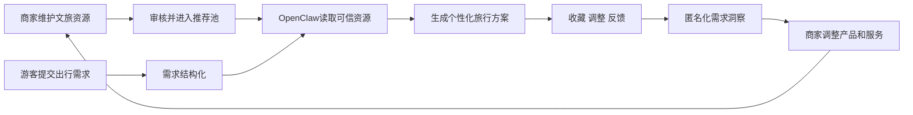
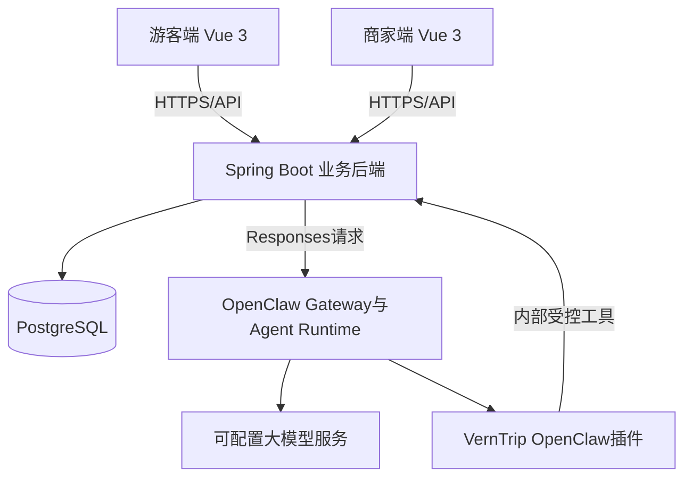

# 山水灵 VernTrip 文旅智能辅助系统

## 比赛项目文档初稿

| 项目 | 内容 |
| --- | --- |
| 参赛赛题 | 题目六：文旅智能辅助场景基于 AI Coding 或 OpenClaw 引擎规范 |
| 赛题发布单位 | 杭州网易智企科技有限公司 |
| 项目名称 | 山水灵 VernTrip 文旅智能辅助系统 |
| 文档版本 | V0.1 初稿 |
| 编制日期 | 2026 年 8 月 6 日 |
| 参赛学校 | 待补充 |
| 团队名称 | 待补充 |
| 团队成员 | 待补充 |
| 指导教师 | 待补充 |

> 本文档用于比赛申报、项目答辩和演示准备。文中“已实现”指当前代码和演示环境已经具备并经过验证的能力；“开发中”和“规划中”不计入现阶段完成成果。

## 编制依据

1. [第二届浙江省大学生人工智能竞赛赛题附件](../题目/附件1：第二届浙江省大学生人工智能竞赛赛.docx)。
2. [VernTrip 项目设计说明书](VernTrip项目设计文档.md)。
3. [VernTrip OpenClaw 嵌入施工方案](../openclaw嵌入/OpenClaw嵌入施工方案.md)。
4. 当前项目源代码、数据库迁移、自动化测试和本地演示环境。

## 1. 项目摘要

山水灵 VernTrip 是一套面向游客与文旅经营者的双端智能辅助系统。项目围绕景区、酒店、餐饮和文化体验等文旅资源，建设统一资源库，并将游客需求、旅行方案、商家产品和营销内容纳入同一业务链路。

游客可以使用自然语言描述出发地、出行日期、同行人群、预算和兴趣偏好。系统同步结构化旅行条件，OpenClaw 通过受控工具读取后台文旅资源目录并完成分日行程编排；Spring 后端对资源名称、节点数量、住宿位置和预算上限进行校验，通过后再保存包含日程、预算、推荐理由和风险提示的旅行方案。商家可以维护文旅资源及其发布状态，已上线资源进入游客推荐池，供咨询和规划流程使用。

项目不是在页面中简单接入一个聊天接口，而是将 OpenClaw 作为系统内部的智能体运行引擎。OpenClaw 负责会话编排、Skill 约束和工具调用，VernTrip 后端负责身份、权限、数据和业务规则。浏览器不直接持有 OpenClaw 凭证，模型也不能自行声明用户身份或扩大数据访问范围。

当前版本已完成游客旅行规划闭环、商家文旅资源管理闭环、OpenClaw 需求对话与结构化行程编排主链路，以及游客与商家角色隔离。旅游产品设计、真实营销内容生成和聚合游客洞察正在按比赛演示路径继续开发。

## 2. 赛题理解与项目定位

### 2.1 赛题要求

题目六要求围绕文旅行业的消费体验同质化、客源转化效率低和产品创新迭代慢等问题，开发基于 AI Coding 或 OpenClaw 引擎的文旅全场景智能辅助 Skill 系统。赛题明确提出以下能力方向：

1. 文旅场景智能咨询应答。
2. 个性化游玩、旅居和餐饮方案规划。
3. 文旅营销内容智能生成。
4. 特色文创与服务产品创新赋能。
5. 客源需求精准匹配。
6. 覆盖景区服务、酒店旅居、餐饮消费、文旅营销和产品研发等业务场景。

### 2.2 项目切入点

文旅服务的主要问题并不是缺少通用信息，而是游客需求与商家资源之间缺少稳定、可信的连接方式。

游客侧存在三个常见困难：一是信息分散，需要在多个平台反复查询；二是通用路线难以同时满足预算、同行人群和兴趣偏好；三是生成式内容可能引用未经核验的地点、价格或开放信息。

商家侧也存在三个问题：一是资源资料分散，缺少统一维护和发布机制；二是产品设计依赖经验，难以及时响应游客需求变化；三是营销内容与真实资源脱节，容易出现重复表达、信息过期或承诺不准确。

VernTrip 以“可信资源库”为基础，以“游客需求”为入口，以“OpenClaw 受控工具调用”为智能执行方式，形成供需两端可以持续反馈的业务闭环。

### 2.3 项目定位

项目定位为文旅经营辅助与游客行程服务平台，不建设完整的在线旅行交易系统。比赛版本重点验证以下内容：

- 游客需求能否被准确转为结构化旅行条件。
- 行程是否建立在后台已维护的真实资源上。
- 商家更新资源后，游客侧能否及时使用。
- OpenClaw 是否真正参与任务执行，而不是仅作为页面标签。
- 用户身份、工具权限和运行回退是否清晰可控。

## 3. 建设目标

1. 建立景区、文化场馆、住宿、餐饮和体验活动的统一资源目录。
2. 支持游客通过自然语言完成旅行需求采集，减少复杂表单操作。
3. 生成符合日期、预算、同行人群、兴趣和节奏要求的多日旅行方案。
4. 支持商家维护资源、组合产品，并围绕真实资源生成运营内容。
5. 将游客的匿名化需求和使用反馈转化为产品改进依据。
6. 建立 OpenClaw 与业务系统之间的可信会话、工具权限和故障回退机制。
7. 形成可用于旅游管理、文化创意和数字媒体等专业教学实训的完整案例。

## 4. 用户与业务闭环

### 4.1 游客端

游客端主要承担需求采集和服务交付，核心流程如下：

```text
登录游客账号
  → 描述出行需求
  → 系统同步日期、预算、同行人群和兴趣
  → OpenClaw 读取已上线文旅资源
  → OpenClaw 编排分日旅行方案
  → 后端校验并保存方案
  → 查看预算、理由、风险和来源
  → 局部调整或收藏方案
```

当前游客端采用“先说需求，再补条件”的交互方式。用户可以直接输入“从上海出发，周末两天带孩子慢游杭州，想体验非遗和本地美食，预算 3000 元”，无需先完成多页表单。系统识别缺失条件后继续询问，条件完整后生成方案。

### 4.2 商家端

商家端主要承担资源维护、产品组织和运营分析，目标流程如下：

```text
维护景区、酒店、餐饮和体验资源
  → 完善来源、标签、价格和服务条件
  → 审核并上线资源
  → 组合形成主题产品或套餐
  → OpenClaw 根据游客需求完成匹配
  → 生成营销内容草稿
  → 查看匿名化需求和产品表现
```

当前版本已经完成资源列表、资源新增和上下线。已上线资源对游客侧可见；游客账号不能访问商家资源管理接口。

### 4.3 双端闭环



## 5. 功能设计

### 5.1 游客端功能

#### 5.1.1 身份登录

系统根据账号角色进入对应端。游客账号进入游客首页，商家账号进入商家工作台。前端路由和后端接口同时执行角色限制，避免只依赖页面隐藏功能。

#### 5.1.2 智能需求采集

系统从游客自然语言中提取以下条件：

- 出发地与目的地。
- 出行日期与天数。
- 同行人群。
- 总预算。
- 行程节奏。
- 兴趣主题和补充要求。

条件不足时继续询问；条件完整时进入方案生成。结构化结果由后端保存，便于后续调整和评测。

#### 5.1.3 个性化旅行规划

旅行方案包含：

- 方案主题与适配度。
- 分日、分时段安排。
- 景点、文化体验、餐饮和住宿建议。
- 预算总额及费用构成。
- 推荐理由和风险提示。
- 资源来源。
- 重新规划、局部调整和收藏操作。

当前演示场景为“杭州亲子非遗两日游”。OpenClaw 从已上线资源中选择节点并生成两日行程，后端完成可信校验后入库；游客根据降低预算、放慢节奏等要求重新规划时，系统生成新版本而不是覆盖原方案。

#### 5.1.4 旅行方案抽选

该功能规划为后续特色模块。系统将在满足日期、预算、距离、同行人群和排除项等硬约束的候选方案中进行加权抽选。抽选结果仍需提供具体行程和推荐依据，不采用无约束随机生成。

### 5.2 商家端功能

#### 5.2.1 经营总览

经营总览展示资源数量、推荐池状态、近期方案引用、待处理事项和游客兴趣趋势。当前页面已完成演示界面，部分经营指标使用演示数据，后续将由真实业务记录汇总生成。

#### 5.2.2 文旅资源管理

资源覆盖文化场馆、自然景观、非遗体验、餐饮、住宿和城市休闲等类型。当前已实现：

- 从 PostgreSQL 读取资源列表。
- 新增资源名称、类型、区域、简介和标签。
- 计算资源信息完整度分数。
- 将资源设置为待完善、已上线或已停用。
- 仅将已上线资源提供给游客规划和 OpenClaw 工具。
- 对商家接口执行身份验证和角色检查。

截至本初稿编制时，演示数据库包含 13 条杭州文旅资源。

#### 5.2.3 产品与套餐

该模块正在开发。计划支持商家从已上线资源中选择景点、餐饮、住宿和体验活动，组合为一日或多日主题产品，维护目标客群、价格、服务说明和发布状态。发布后的产品将参与游客匹配和旅行规划。

#### 5.2.4 智能内容

页面原型已完成，真实 OpenClaw 生成接口尚在开发。正式流程将以资源或产品为依据，生成小红书文案、公众号内容、短视频口播稿和产品详情页草稿。系统不会让模型自行编造价格、开放时间和服务承诺，生成结果默认进入草稿状态。

#### 5.2.5 游客洞察

页面原型已完成，真实聚合统计尚在开发。后续将围绕游客预算、同行人群、兴趣主题、方案收藏、资源替换和未满足需求生成匿名化分析，不向商家直接提供游客个人信息。

### 5.3 当前功能完成情况

| 能力 | 当前状态 | 说明 |
| --- | --- | --- |
| 游客与商家分角色登录 | 已实现 | 登录后按角色跳转，后端限制商家接口 |
| 游客自然语言需求采集 | 已实现 | 支持多轮补充并输出结构化需求 |
| OpenClaw 需求对话与行程编排 | 已实现 | OpenClaw 读取可信资源并生成结构化行程，后端校验后入库 |
| 文旅资源可信读取 | 已实现 | OpenClaw 通过受控工具读取已上线资源 |
| 多日行程生成 | 已实现 | 包含预算、日程、理由、风险和来源 |
| 行程局部调整与版本 | 已实现 | 新方案保留父版本关系 |
| 行程收藏 | 已实现 | 支持收藏和取消收藏 |
| 商家资源新增与上下线 | 已实现 | 数据写入 PostgreSQL |
| 产品与套餐管理 | 开发中 | 当前完成前端原型 |
| OpenClaw 营销内容生成 | 开发中 | 当前页面内容生成仍为演示逻辑 |
| 聚合游客洞察 | 开发中 | 当前页面使用演示指标 |
| 旅行方案抽选 | 规划中 | 完成业务规则，尚未进入开发 |
| 地图路线展示 | 开发中 | 已完成高德地图路线组件和资源坐标模型，当前演示环境待配置地图密钥 |
| 其他实时外部数据 | 规划中 | 暂未接入天气、票务和酒店库存平台 |

## 6. 系统架构

### 6.1 总体架构



### 6.2 技术选型

| 层级 | 技术 | 用途 |
| --- | --- | --- |
| 前端 | Vue 3、Vue Router、Vite | 游客端和商家端交互界面 |
| 后端 | Java 21、Spring Boot 3.3.4 | 业务接口、身份权限和智能引擎编排 |
| 数据库 | PostgreSQL、Spring Data JPA、Flyway | 用户、资源、需求、行程和运行记录持久化 |
| 智能体引擎 | OpenClaw 2026.7.1 | Agent 运行、Skill 约束、工具选择和模型调用 |
| 插件 | TypeScript、OpenClaw Plugin SDK | 将 VernTrip 业务能力注册为原生工具 |
| 测试 | JUnit、MockMvc、Node Test | 接口、权限、Gateway 和插件工具验证 |

### 6.3 部署方式

当前开发环境采用本机原生部署：Vue 前端运行在 `5173` 端口，Spring Boot 后端运行在 `8080` 端口，OpenClaw Gateway 运行在 `18789` 端口。项目同时保留 Docker Compose 配置，但日常开发和现场演示不依赖 Docker。

## 7. OpenClaw 嵌入设计

### 7.1 嵌入方式

VernTrip 采用“固定版本 OpenClaw 运行时 + VernTrip 原生插件 + VernTrip Skill + 内部工具接口”的方式接入。OpenClaw 是项目运行组件的一部分，不由前端直接调用，也不需要修改 OpenClaw 核心源码。

具体职责如下：

- OpenClaw 负责模型调用、Agent 执行、Skill 约束和工具调用。
- Spring Boot 负责用户身份、商家角色、数据范围和业务事务。
- VernTrip 插件负责把资源查询等能力注册为 OpenClaw 原生工具。
- 数据库保存资源、需求、行程版本和 OpenClaw 会话映射。

### 7.2 当前工具

| 工具 | 作用 | 权限特点 |
| --- | --- | --- |
| `verntrip_runtime_status` | 检查插件与内部服务状态 | 不返回密钥 |
| `verntrip_workspace_scope_read` | 读取可信会话绑定的工作区资料 | 不接受模型传入的用户身份 |
| `verntrip_tourism_catalog_read` | 读取指定城市的已上线文旅资源 | 只返回后台允许的数据范围 |

当回答涉及具体景点、餐饮、住宿或体验活动时，OpenClaw 必须先调用 `verntrip_tourism_catalog_read`。如果资源库未覆盖某城市，系统应明确提示证据不足，不使用模型记忆补写不存在的资源。

### 7.3 可信会话

Spring Boot 将业务会话映射为 OpenClaw session key。插件根据可信会话恢复用户和工作区范围，工具参数不包含 `userId`、Gateway Token 或服务 Token。该设计避免模型通过修改参数访问其他用户或商家的数据。

### 7.4 引擎模式与回退

系统保留三种运行模式：

| 模式 | 作用 |
| --- | --- |
| `legacy` | 仅使用原有助手链路，便于紧急回退 |
| `shadow` | 原助手正常返回，OpenClaw 在后台执行并记录对比结果 |
| `openclaw` | OpenClaw 作为主要引擎，旧链路作为故障回退 |

当前演示环境使用 `openclaw` 模式。OpenClaw 请求发生超时或故障时，后端可按配置回退，避免直接丢失游客输入。

### 7.5 后续 Skill 规划

在现有基础 Skill 之上，项目计划继续拆分以下文旅 Skill：

- `itinerary-plan`：生成和调整旅行方案。
- `tourism-product-design`：生成文旅产品草稿。
- `tourism-marketing`：生成营销内容草稿。
- `customer-demand-match`：计算游客需求与产品适配度。
- `tourism-fact-check`：检查价格、开放时间和宣传表述。
- `travel-lottery`：执行受约束的旅行方案抽选。

## 8. 数据设计

当前核心数据包括：

| 数据对象 | 主要内容 |
| --- | --- |
| 用户 | 账号、显示名称、角色和状态 |
| 文旅资源 | 城市、名称、类型、区域、简介、标签、来源、价格和发布状态 |
| 出行需求 | 目的地、出发地、日期、天数、同行人群、预算、节奏和兴趣 |
| 旅行方案 | 用户、需求、版本、父版本、标题、摘要、匹配度和估算预算 |
| 行程节点 | 日期序号、时间、资源、说明、费用和来源 |
| 反馈 | 收藏、取消收藏和后续评价记录 |
| OpenClaw 会话 | 业务用户、工作区和 OpenClaw session key 的可信映射 |
| Shadow 记录 | 新旧引擎状态、耗时、输出和错误信息 |

数据库变更统一使用 Flyway 管理，确保比赛演示环境可以重建并保持结构一致。

## 9. 项目特点

### 9.1 游客与商家共用同一资源闭环

多数行程生成演示只关注游客输入和模型输出。VernTrip 将商家资源维护纳入系统：商家创建并上线资源后，资源进入游客推荐池；资源停用后，不再向游客规划提供。该设计使生成结果与经营数据保持一致。

### 9.2 OpenClaw 作为内部引擎

项目没有把 OpenClaw 当作前端聊天 API，而是通过 Gateway、Plugin SDK、Skill 和可信工具形成独立运行层。OpenClaw 可以升级或停用，业务数据和权限仍由 VernTrip 保持。

### 9.3 先取证再生成

涉及具体文旅地点时，模型必须先读取后台目录，只能使用工具返回的资源。资源返回内容包含类型、区域、价格区间、标签和来源，减少无依据推荐。

### 9.4 局部调整与版本留痕

游客要求降低预算或改变节奏时，系统创建新版本并保留父方案，不直接覆盖原结果。该方式便于比较调整前后差异，也为后续收集明确偏好提供基础。

### 9.5 可切换和可验证

项目保留 `legacy`、`shadow` 和 `openclaw` 模式，并为 Gateway 请求、内部工具、权限隔离和旅游规划编写自动化测试。技术演示不仅展示最终页面，也可以说明引擎如何运行和如何回退。

## 10. 安全与合规设计

1. 浏览器只访问 Spring Boot 后端，不直接访问 OpenClaw Gateway。
2. Gateway Token 和内部服务 Token 不进入前端代码、页面或业务请求。
3. OpenClaw 工具不接受模型自行填写的用户身份和数据范围。
4. 商家接口需要有效登录，并限制为 `MERCHANT` 角色。
5. 游客只能读取已上线的文旅资源。
6. 商家侧游客洞察仅使用匿名化和聚合数据。
7. 资源来源不足时不生成确定性事实。
8. 正式发布、价格修改和批量触达等高风险操作将保留人工确认。
9. OpenClaw 故障时保留回退路径，避免影响基础业务可用性。

## 11. 测试与评价方案

### 11.1 已完成验证

- 前端生产构建通过。
- OpenClaw 插件可完成构建和 Node 测试。
- OpenClaw Gateway Client 测试通过。
- OpenClaw 内部工具鉴权和会话范围测试通过。
- 游客需求提取、行程生成、调整和收藏集成测试通过。
- 商家新增资源、上线资源和游客侧读取集成测试通过。
- 游客账号访问商家资源接口返回 `403`。
- 真实演示请求已返回 `engine=openclaw`，两日行程的资源、预算和住宿约束校验通过。
- 浏览器端已完成游客一键生成行程和商家新增上线资源的实际操作验收。

### 11.2 比赛前评价指标

| 评价项 | 评价方法 | 目标 |
| --- | --- | --- |
| 需求提取准确率 | 使用标准需求样本核对字段 | 不低于 90% |
| 硬约束满足率 | 检查日期、预算、天数和同行人群 | 100% |
| 资源可追溯率 | 检查具体资源是否来自工具返回 | 100% |
| 越权拦截率 | 游客访问商家接口、错误令牌访问内部工具 | 100% |
| 规划成功率 | 重复执行标准演示用例 | 不低于 95% |
| OpenClaw 工具成功率 | 统计目录读取与运行错误 | 不低于 95% |
| 故障回退有效性 | 关闭 Gateway 后执行标准请求 | 基础请求不丢失 |
| 页面可用性 | 桌面端与移动端关键流程检查 | 无阻断问题 |

目标值需要在比赛前通过固定数据集和重复测试形成正式测试报告，不能以单次演示结果代替。

## 12. 比赛演示方案

演示以“杭州亲子非遗两日游”为主线，建议控制在 6 至 8 分钟。

### 12.1 商家侧资源准备

1. 使用商家账号登录工作台。
2. 进入文旅资源管理，展示数据库中的资源和质量分。
3. 新增一条非遗体验资源，填写区域、简介和标签。
4. 新资源初始为待完善状态，点击上线后推荐池数量增加。
5. 说明游客账号无法访问该管理接口。

### 12.2 游客侧旅行规划

1. 使用游客账号登录。
2. 点击“一键体验完整演示”，或输入标准需求文本。
3. 展示 OpenClaw 对出发地、日期、天数、同行人群、预算和兴趣的识别结果。
4. 生成“杭州非遗慢游 2 日计划”。
5. 展示分日安排、适配度、预算构成、推荐理由和资源来源。
6. 执行收藏或局部调整，说明方案版本关系。

### 12.3 技术说明

1. 展示 Spring Boot、OpenClaw Gateway 和前端三项服务状态。
2. 说明 `verntrip_tourism_catalog_read` 的调用边界。
3. 说明浏览器不持有 Gateway Token，模型不能自行传入用户身份。
4. 说明 `legacy`、`shadow` 和 `openclaw` 三种模式的用途。

## 13. 开发计划

### 13.1 第一阶段：已完成

- OpenClaw 运行时、插件和基础 Skill 嵌入。
- Spring Boot 与 OpenClaw Gateway 主链路。
- 游客需求采集、OpenClaw 结构化行程生成、调整和收藏。
- 游客与商家双角色登录和路由。
- 商家资源数据库读取、新增和上下线。
- 核心权限和集成测试。

### 13.2 第二阶段：当前开发重点

- 建立旅游产品与资源关联数据模型。
- 完成产品与套餐的创建、编辑、定价和上下线。
- 将商家智能内容页面接入真实 OpenClaw 生成链路。
- 将游客方案引用、收藏和替换记录汇总为基础洞察。

### 13.3 第三阶段：比赛完善

- 完成旅行方案抽选基础功能。
- 增加 OpenClaw 运行记录和工具调用展示。
- 补充事实检查、信息过期和冲突提示。
- 完成固定评测集、性能测试和故障回退测试。
- 优化移动端适配、演示数据和答辩材料。

## 14. 应用价值

### 14.1 对游客

减少跨平台查询和手工拼接路线的时间，以较低操作成本获得符合预算、同行人群和兴趣的旅行方案，并能查看推荐依据和资源来源。

### 14.2 对文旅商家

统一维护景区、住宿、餐饮和体验资料，让资源能够被智能咨询、行程规划和产品设计重复使用；通过匿名化需求分析调整产品，降低内容重复制作和产品试错成本。

### 14.3 对教学实训

项目可以拆分为旅游资源运营、游客需求分析、产品设计、数字内容制作、智能体工具开发和数据安全等实训任务，适配旅游管理、文化创意、数字媒体和软件技术等专业协同实践。

## 15. 当前限制

1. 演示数据目前以杭州为主，尚未形成多城市资源体系。
2. 产品套餐、营销内容和游客洞察尚未完成数据库闭环。
3. 地图路线代码已经接入，但当前演示环境尚未配置高德地图密钥；实时天气、票务和酒店库存仍未接入。
4. 资源来源仍以演示整理资料为主，需要在比赛前补充正式来源和核验时间。
5. 推荐效果尚未形成独立评测集和完整对照实验。
6. 当前以单商家演示为主，多租户资源归属需要继续完善。

上述限制不影响当前游客规划与商家资源管理演示，但应在答辩中如实说明。

## 16. 预期提交材料

- 项目源代码与版本说明。
- 项目作品报告。
- 系统架构与功能说明。
- OpenClaw 嵌入和 Skill 设计说明。
- 部署与启动手册。
- 测试报告与评测数据。
- 比赛演示视频。
- 答辩演示文稿。
- 演示账号和标准演示脚本。

## 17. 演示环境信息

| 项目 | 内容 |
| --- | --- |
| 系统访问地址 | `http://127.0.0.1:5173/` |
| 游客演示账号 | `demo / demo123` |
| 商家演示账号 | `merchant / merchant123` |
| 前端端口 | `5173` |
| 后端端口 | `8080` |
| OpenClaw Gateway 端口 | `18789` |
| 当前主要引擎 | `openclaw` |

## 18. 待补充信息

正式定稿前需要补充以下内容：

1. 学校、团队、成员和指导教师信息。
2. 作品 Logo、系统截图和架构图图片版本。
3. 正式资源来源与授权说明。
4. 测试数据规模、评测结果和性能统计。
5. 团队成员分工与开发过程记录。
6. 软件著作权、开源协议和第三方依赖说明。
7. 比赛要求的固定格式、页数和签章信息。

## 19. 结语

VernTrip 当前已经具备可运行的双端基础系统，并完成 OpenClaw 与文旅业务数据的实际连接。项目后续工作的重点不是继续增加孤立页面，而是沿着“资源维护、产品组合、智能匹配、游客规划、反馈分析”的业务链路逐步补齐。通过受控工具、可信资源和明确权限，系统能够在发挥生成式智能能力的同时，保持文旅信息和业务操作的可核验性。
